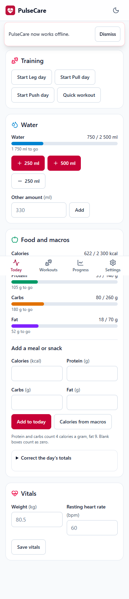
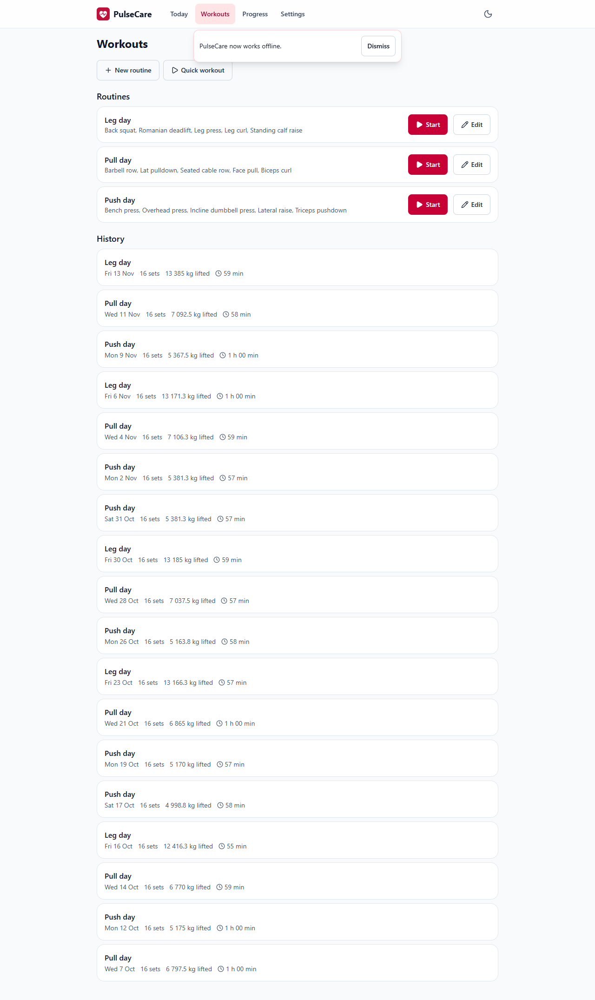
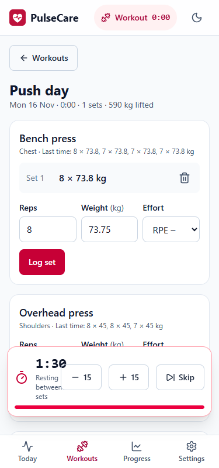
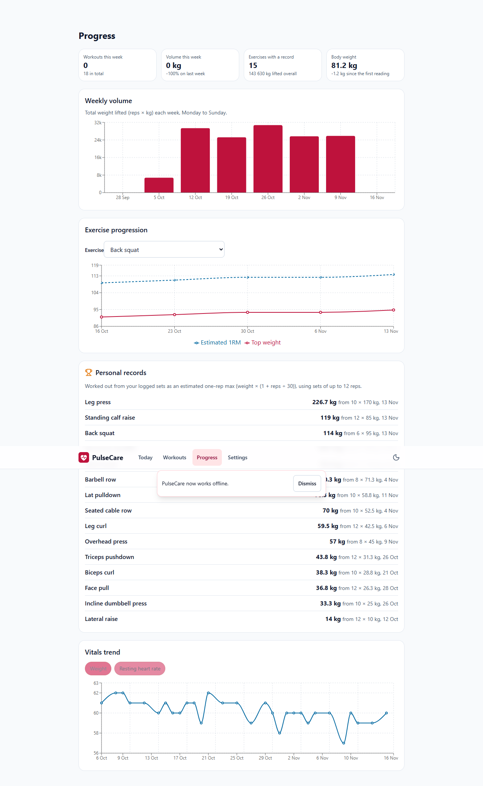

# PulseCare

A mobile-first fitness companion: build workout routines, log sets with a rest timer, track water, macros and vitals, and watch weekly volume, lift progression and personal records in charts. It installs as an app and works with no connection.

**Live demo:** https://pulsecare-148.netlify.app



## What to demo to a recruiter
- Open the app: six weeks of realistic Push / Pull / Legs history, daily logs and a half-finished "today" are already there. No sign-up.
- Tap **Start Push** on Today, log a set (the form is pre-filled with last session's numbers) and watch the rest timer start. Finish the workout and see any new personal record flagged.
- Open **Progress**: weekly volume, the progression line for any lift, the personal-record list (estimated 1RM) and weight / resting-heart-rate trends. Everything is computed from the logged sets, nothing is hand-entered.

## Expo or PWA? (decision for step 1)
The brief allows either React Native with Expo or a React + Vite PWA. **This is a PWA.** It deploys to Netlify as a plain static site, installs from the browser, runs offline, and keeps all data on the device in IndexedDB (Dexie). A native Expo build was not done, so there is no app-store build, no native notifications and no background timer. The rest timer is built on an end time so it stays correct when a phone locks and the page wakes up later.

## Features
- **Routines and workouts:** build routines from a 24-exercise library (or add your own), start one or a quick workout, log sets (weight, reps, optional RPE) with "last time" hints, edit or delete a set, finish or discard the session.
- **Rest timer:** a default length you set in Settings, +/- 15 s while it runs, a bar fixed above the tab bar, and a double beep and vibration when time is up (best effort, browsers only allow sound after a tap).
- **Daily logging:** water with quick buttons, meals with macros and automatic kcal check, weight and resting heart rate, all against editable daily targets. Step back through earlier days to fix a missed entry.
- **Analytics:** weekly volume (Monday weeks), per-exercise progression and personal records. Personal records are derived from the sets (Epley estimated 1RM, capped at 12 reps because the formula drifts above that), never stored, so editing or deleting a set corrects them.
- **Installable and offline:** web manifest, precached app shell, and an update banner that lets the user choose when to reload (prompt mode). Dark and light theme.

### Phase 2
- Exercise library search and filters
- Photo progress log
- CSV export
- Optional sync to Neon through a Netlify Function
- A native Expo build

## Stack
React 19, Vite, TypeScript (strict), Tailwind CSS 4, Dexie (IndexedDB), Recharts (lazy-loaded), lucide-react, vite-plugin-pwa, Vitest, oxlint.

## Architecture notes
- **Pure logic first.** `src/lib/` holds the maths as plain functions with tests: `strength.ts` (Epley e1RM, set volume, weekly volume, records, progression, last performance), `nutrition.ts` (targets, adding water and meals, macro kcal at 4/4/9), `restTimer.ts` (remaining seconds, clock formatting, adjusting the rest) and `date.ts`.
- **One data layer.** `src/db/repo.ts` is the only code that writes to Dexie. It validates input (positive reps, sane weight, RPE range, no negative macros), allows a single active workout, cascades deletes (discarding a session removes its sets; deleting a routine keeps past sessions and clears their `routineId`) and wraps multi-step writes in transactions.
- **Live queries.** `PulseDataProvider` exposes the data through `dexie-react-hooks`, so every screen updates the moment a write lands. Daily-log updates go through a small queue so rapid taps on "+250 ml" never overwrite each other.
- **Safe demo seed.** `buildDemo()` is deterministic. It is inserted after the page has loaded and gone idle (keeps first paint and Lighthouse fast) by `seedIfEmpty`, which counts and inserts in a single transaction, so it can never overwrite something the user saved in the meantime.
- **Charts are code-split.** Recharts loads only when Progress is opened, so the main bundle stays near 112 kB gzipped.
- Hash-based routing (`#/today`, `#/workouts`, `#/progress`, `#/settings`, `#/workout/:id`, `#/routine/:id`) so a static host needs no rewrite rules.

## Run locally
```bash
npm install
npm run dev          # http://localhost:5313
```
Checks: `npm run typecheck`, `npm run lint`, `npm test` (120 tests), `npm run build`. Try the installable build with `npm run build && npm run preview` (http://localhost:4183). No environment variables are needed.

## What was verified, and what was not
- Verified: typecheck, lint, 120 unit tests, production build, and 103 real-browser checks (Chromium via Playwright) at 375 px and 1280 px covering routines, a full workout with the rest timer, nutrition logging, progress charts, settings and offline reload, with no console errors. The dark theme was only checked by eye. Lighthouse on the preview build: Performance 99, Accessibility 100, Best Practices 100, SEO 100.
- Not verified: a real phone, iOS Safari installation, the beep on real hardware, a long-term data volume test, and a deployed Netlify build.
- PulseCare is a logging tool, not medical or nutrition advice. The demo history is synthetic.

## Screenshots
| Workouts | Session | Progress |
| --- | --- | --- |
|  |  |  |

## Status
Built and tested locally. Deploy pending.